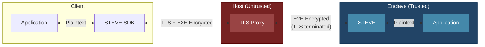

# STEVE

**S**ecure **T**ransport **E**ncryption **V**ia **E**nclave

End-to-end encryption for browser and native applications communicating with AWS Nitro Enclaves. With a v2 client active, application traffic is encrypted at the client and decrypted only inside the enclave.

See the [normative STEVE v2 protocol specification](docs/steve-v2-protocol.md).

> [!IMPORTANT]
> v2 supports process-pinned X25519 or X-Wing draft-10 sessions and binds the
> selected suite into the transcript and Nitro evidence. X-Wing protects
> session secrecy independently of expected-deployment identity, but does not
> provide trusted first-load bootstrap or expected-PCR delivery. STEVE rejects
> plaintext application routing by default. Native clients require an explicit
> PCR policy: reviewed pinned profiles or caller-persisted trust on first use
> (TOFU). The browser SDK supports the same policies, but leaves PCR policy
> optional for backward compatibility.

## Architecture



## Two Layers of Encryption

| Layer | From | To | Purpose |
|-------|------|-----|---------|
| **TLS** | Client | Host Proxy | Transport security (terminated at host) |
| **E2E** | STEVE SDK | STEVE | Application security (terminated in enclave) |

For requests intercepted by the active v2 worker, the host terminates TLS but only sees encrypted E2E payloads.

## How It Works

1. **Session request**: The client generates a nonce and ephemeral X25519 or X-Wing key, sends its pinned suite, and commits to its origin.
2. **Attested key exchange**: STEVE uses its process-fixed suite and asks Nitro to attest the suite, transcript, nonce, session ID, origin context, and key-derived binder.
3. **Verification and confirmation**: The client verifies the expected suite in the response and Nitro binding, then confirms possession of the derived keys.
4. **Request Flow**:
   - Application makes request through STEVE SDK
   - SDK encrypts payload with AES-256-GCM
   - Request travels over TLS to host proxy
   - Host terminates TLS, forwards E2E-encrypted payload to enclave
   - STEVE decrypts, forwards plaintext to enclave application
5. **Response Flow**: Responses use the reverse-direction key and the request sequence.

## Components

| Component | Location | Description |
|-----------|----------|-------------|
| `steve` | Enclave | Rust proxy - decrypts requests, encrypts responses |
| `steve-sdk` | Client (Rust) | Native SDK with pinned-allowlist and TOFU PCR policies |
| `steve-sdk-uniffi` | Client (Swift) | Generated Swift facade over the native Rust SDK |
| `steve-cli` | Client (Rust) | One-request CLI using the native SDK policies |
| `steve-js-sdk` | Client (Browser) | Service worker for web applications |

At startup `steve` writes enclave metadata to `E2P_METADATA_FILE` (default
`/metadata.json`), which bootproofd embeds as attestation `user_data`. In v2
this carries `{"e2p_protocol_version":2,"e2p_key_exchange":"..."}` — the v1
persistent `verifying_key` is intentionally gone, since attestation is now
bound per session.

`STEVE_KEY_EXCHANGE` accepts only `X25519` or `XWING-DRAFT10`. Omission selects
X25519. The suite is fixed for the process lifetime; changing it requires a
new enclave build/deployment.

STEVE rejects non-E2P application requests by default with
`403 {"error":"e2e_required"}`. Set
`STEVE_ALLOW_PLAINTEXT_FALLBACK=true` only for deployments that intentionally
retain legacy plaintext forwarding. The value must be exactly `true` or
`false`; invalid values fail startup. The default root-scope browser bootstrap
remains available: `GET /` and `GET`/`HEAD` for `/enclave-sw.js`,
`/register.js`, `/attestation-widget.js`, and
`/xwing/steve_xwing_wasm_bg.wasm` are forwarded as public bootstrap material.
Custom service-worker scopes or bootstrap paths require matching narrow ingress
routes; they do not enable general plaintext application forwarding.

## Security Properties

- **E2E Encryption**: Data encrypted client ↔ enclave (AES-256-GCM)
- **Attestation-Bound Keys**: Fresh Nitro evidence commits to the exact v2 session transcript and derived key binder
- **Hybrid Session Secrecy**: X-Wing combines ML-KEM-768 and X25519; X25519 remains the compatibility default
- **Downgrade Resistance**: Clients pin the suite and verify the wire response, transcript, and attestation binding without fallback
- **Replay Resistance**: Directional keys, derived IVs, authenticated sequences, and a 64-entry server replay window
- **Host Isolation**: On the v2 path, the host sees only ciphertext despite terminating TLS

Current limitations:

- Browser PCR policy is optional; omitting it reports `not-checked` and does
  not authenticate the expected deployment.
- Deployments must keep the application upstream private; fail-closed STEVE routing does not protect a separately exposed app port.
- Same-origin page, worker, configuration, and expected-PCR delivery are not
  independently trusted on first load.
- Browser TOFU provides continuity after first use, not first-use workload
  identity. Losing the TOFU record or clearing all same-origin site data reopens
  enrollment; losing only the persisted policy configuration fails closed while
  its policy-required marker remains.
- Browser WASM must not be described as inherently constant-time; its supported-browser side-channel posture requires independent review.

## Usage

### Browser (JavaScript)

```javascript
import { registerEnclaveServiceWorker } from 'steve-js-sdk';

const client = await registerEnclaveServiceWorker({
  config: {
    pcrPolicy: {
      mode: 'pinned',
      profiles: [{ PCR0: pcr0Hex, PCR1: pcr1Hex, PCR2: pcr2Hex }]
    }
  }
});
await client.initialize(); // Optional eager establishment

// Same-origin fetch() calls are now transparently E2E encrypted
const response = await fetch('/api/secret');
```

For a browser application hosted on another origin, configure the enclave
origin and fetch it explicitly:

```javascript
const client = await registerEnclaveServiceWorker({
  config: {
    enclaveOrigin: 'https://secure.example',
    expectedKeyExchange: 'XWING-DRAFT10',
    pcrPolicy: {
      mode: 'pinned',
      profiles: [{ PCR0: pcr0Hex, PCR1: pcr1Hex, PCR2: pcr2Hex }]
    },
    requestTimeoutMs: 30000
  }
});
await client.initialize(); // Optional eager establishment

const response = await fetch('https://secure.example/api/secret');
```

Omitting `pcrPolicy` retains the compatibility behavior: PCRs are reported as
`not-checked` and do not authenticate the expected deployment.

For an explicit protected call, `client.send('/api/secret')` routes an
origin-relative path through E2P without SDK retries and returns both the
`Response` and protecting session ID. STEVE does not follow upstream redirects;
the call returns their `3xx` response, while a redirect of the outer protocol
request fails. Client methods expose structured `SteveError` fields (`code`,
`stage`, `message`, and optional `httpStatus`). The worker serializes PCR policy
configuration replacement and resets the session; the next session enforces the
new policy, and existing TOFU records are not migrated. See
[the browser SDK API](steve-js-sdk/README.md#client-api).

`expectedKeyExchange` defaults to `X25519`; X-Wing deployments must set
`XWING-DRAFT10` explicitly. Initialization, CSP, response, or
attestation failures abort without X25519 fallback.

`initialize()` eagerly establishes the session and is recommended when the
application wants attestation failures before its first protected request. It
is idempotent and optional: the first protected request establishes a session
when needed. If the browser restarts the service worker and its in-memory
session is lost, the next protected request establishes a fresh session.

`client.getStatus()` reports the worker lifecycle and safe session diagnostics:
the protocol and key-establishment suite, KDF and record protection, base64url
session ID and transcript hash, establishment trigger and rotation time, and
attestation checks. When `pcrPolicy` is omitted, PCRs are reported but not
checked. With a pinned or TOFU policy, the worker
enforces the policy before application traffic. `attestation.pcrTrust` reports
`not-checked`, `pinned`, `tofu-enrolled`, or `tofu-matched`. Status never includes
private keys, shared secrets, derived traffic keys, binders, nonces, or
application plaintext.

Set `STEVE_CORS_ORIGINS` to the browser application's origin (for example,
`http://localhost:3000`). STEVE applies that policy only to `/e2p/v2/*`;
explicitly enabled plaintext fallback routes retain the upstream application's CORS policy.
Wildcard origins are rejected; production deployments must list each allowed
browser origin explicitly.

STEVE does not follow redirects from the enclave-local application; it returns
the upstream `3xx` response to the client. Upstream connections use a 5-second
connect timeout, a 30-second idle-read timeout, and a 5-minute total timeout.
Protected and plaintext upstream responses are both limited to 33,554,432
bytes; timeout, read, or size failures return an upstream failure without an
automatic retry.

Protected application transactions default to a 30-second deadline
(`requestTimeoutMs` accepts 1,000 through 300,000 milliseconds). Transport
failures do not reset an otherwise valid secure session. The SDK does not
automatically retry timed-out requests because the upstream operation may
already have executed.

The browser SDK requires module service workers, ES2020, WebCrypto, Cache
Storage, and IndexedDB. X25519 mode also requires WebCrypto X25519; X-Wing requires a CSP
that permits the fixed same-origin WASM asset. Unsupported capabilities fail
closed without a classic-worker or cryptographic fallback. See
`steve-js-sdk/README.md` for the tested-browser policy.

### Native (Rust)

The native SDK requires an explicit PCR policy. A pinned policy accepts one or
more reviewed profiles containing at least PCR0/1/2. TOFU records PCR0/1/2 by
default and may include caller-selected additional PCRs. It requires the exact
selected set on later sessions. PCRs are checked together with the Nitro
certificate chain, fresh nonce, session transcript, selected suite, and
derived-key binder.

```rust
use steve_sdk::{Client, ExpectedPcrs};

let expected_pcrs = ExpectedPcrs::from([
    (0, std::fs::read("pcr0.bin")?),
    (1, std::fs::read("pcr1.bin")?),
    (2, std::fs::read("pcr2.bin")?),
]);
let client = Client::new("https://secure.example", expected_pcrs).await?;
let attestation = client.verify_attestation().await?;
let response = client.get("/api/secret").send().await?;
```

X25519 is the default. A native X-Wing deployment must pin
`KeyExchangeSuite::XWingDraft10` explicitly. The suite is checked in the
session response, transcript, and attested binding; there is no negotiation,
metadata preflight, or fallback.

The default context is the normalized STEVE origin. Native applications may add
their own binding with `Client::builder(...).application_context(...)`.
Sessions rotate after 25 minutes. Requests have a 30-second deadline and are
never automatically retried because an upstream operation may already have
executed.

### Native (Swift via UniFFI)

`steve-sdk-uniffi` exposes the native SDK's pinned and TOFU policies,
attestation, rotation, X25519/X-Wing selection, and binary HTTP requests through
generated Swift bindings. Rust continues to own the network stack, Tokio
runtime, attestation, protocol state, cryptography, and session keys.

Swift TOFU uses PCR0/1/2 by default and accepts additional PCR indices at
initialization. The application-owned trust store receives and must preserve
exactly that selected set; the complete signed map remains available in the
attestation result.

Bindings and the static library are generated under `target/`, not committed.
See [`crates/steve-sdk-uniffi/README.md`](crates/steve-sdk-uniffi/README.md) for
the API, generation/linking commands, TOFU callback contract, concurrency, and
security boundary.

### CLI

`steve-cli` is a narrow one-request wrapper around those SDK policies. It uses
`.caution/trusted_hashes.json` by default, accepts repeated `--pcrs` files for
upgrade allowlists, or a mutually exclusive `--tofu-store` for continuity after
first use:

```bash
cargo run -p steve-cli -- --pcrs current.json --pcrs next.json \
  'https://secure.example/api/secret?required=true'
```

See the [`steve-cli` README](crates/steve-cli/README.md) for TOFU, dry-run, and
X-Wing examples and the trust-file boundary.

## Validation

Run these commands from the repository root.

### Local and CI fixture

The local gate uses signed synthetic evidence and runs the browser/WASM and
Rust SDKs against both suites:

```bash
npm --prefix steve-js-sdk ci --ignore-scripts

make test
make test-e2e
make test-swift # macOS-only generated-binding smoke test
```

Manual UI:

```bash
./scripts/test-e2e.sh up
# Synthetic: http://127.0.0.1:3000/local/
# Nitro:     http://127.0.0.1:3000/nitro/
./scripts/test-e2e.sh down
```

Synthetic evidence validates protocol behavior, not Nitro hardware or production
PCRs.

### Production Nitro

Run the full browser/WASM and Rust gate once per deployment:

```bash
export STEVE_REMOTE_ORIGIN=https://secure.example
export STEVE_KEY_EXCHANGE=XWING-DRAFT10
caution verify --attestation-url "$STEVE_REMOTE_ORIGIN/attestation"

export STEVE_TRUSTED_HASHES=/path/to/independently/verified/trusted_hashes.json
export STEVE_EXPECTED_PCR0="$(jq -er .pcr0 "$STEVE_TRUSTED_HASHES")"
export STEVE_EXPECTED_PCR1="$(jq -er .pcr1 "$STEVE_TRUSTED_HASHES")"
export STEVE_EXPECTED_PCR2="$(jq -er .pcr2 "$STEVE_TRUSTED_HASHES")"
make test-e2e-nitro
```

The browser and Rust gates enforce the expected PCRs during connection and
reject a mutated profile before application traffic. Do not source expected
PCRs from the unverified remote response. See [tests/e2e/README.md](tests/e2e/README.md) for CI,
fixture-deployment, focused-test, and trust-boundary details.
