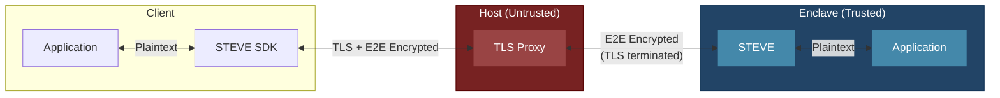

# STEVE

**S**ecure **T**ransport **E**ncryption **V**ia **E**nclave

End-to-end encryption for browser applications communicating with AWS Nitro Enclaves. With the v2 browser client active, application traffic is encrypted in the service worker and decrypted only inside the enclave.

> [!IMPORTANT]
> v2 binds fresh Nitro evidence to the exact X25519 session. It does not yet enforce expected PCRs, independently protect the service-worker bootstrap, or make STEVE fail closed when the service worker is absent. Those controls are separate work.

## Architecture



## Two Layers of Encryption

| Layer | From | To | Purpose |
|-------|------|-----|---------|
| **TLS** | Client | Host Proxy | Transport security (terminated at host) |
| **E2E** | STEVE SDK | STEVE | Application security (terminated in enclave) |

For requests intercepted by the active v2 worker, the host terminates TLS but only sees encrypted E2E payloads.

## How It Works

1. **Session request**: The browser generates a nonce and ephemeral X25519 key, and commits to its origin.
2. **Attested key exchange**: STEVE generates its own ephemeral key and asks Nitro to attest a transcript containing both keys, the nonce, session ID, origin context, and a key-derived binder.
3. **Verification and confirmation**: The browser verifies the Nitro chain, nonce, transcript values, and binder, then confirms possession of the derived keys.
4. **Request Flow**:
   - Application makes request through STEVE SDK
   - SDK encrypts payload with AES-256-GCM
   - Request travels over TLS to host proxy
   - Host terminates TLS, forwards E2E-encrypted payload to enclave
   - STEVE decrypts, forwards plaintext to enclave application
5. **Response Flow**: Responses use the reverse-direction key and the request sequence.

## Components

| Component | Location | Description |
|-----------|----------|-------------|
| `steve` | Enclave | Rust proxy - decrypts requests, encrypts responses |
| `steve-sdk` | Client (Rust) | Rust SDK for native applications |
| `steve-js-sdk` | Client (Browser) | Service worker for web applications |

At startup `steve` writes enclave metadata to `E2P_METADATA_FILE` (default
`/metadata.json`), which bootproofd embeds as attestation `user_data`. In v2
this carries `{"e2p_protocol_version": 2}` — the v1 persistent `verifying_key`
is intentionally gone, since attestation is now bound per session.

## Security Properties

- **E2E Encryption**: Data encrypted client ↔ enclave (AES-256-GCM)
- **Attestation-Bound Keys**: Fresh Nitro evidence commits to the exact v2 session transcript and derived key binder
- **Forward Secrecy**: Ephemeral X25519 keys per session
- **Replay Resistance**: Directional keys, derived IVs, authenticated sequences, and a 64-entry server replay window
- **Host Isolation**: On the v2 path, the host sees only ciphertext despite terminating TLS

Current limitations:

- Expected PCR values are not enforced by the browser client.
- Plaintext requests are still forwarded when the service worker is absent; fail-closed routing is deferred.
- The first-load service-worker bootstrap is not independently trusted.
- The Rust client SDK is skeletal; v2 is currently browser-first.

## Usage

### Browser (JavaScript)

```javascript
import { registerEnclaveServiceWorker } from 'steve-js-sdk';

const client = await registerEnclaveServiceWorker();
await client.initialize(); // Optional eager establishment

// Same-origin fetch() calls are now transparently E2E encrypted
const response = await fetch('/api/secret');
```

For a browser application hosted on another origin, configure the enclave
origin and fetch it explicitly:

```javascript
const client = await registerEnclaveServiceWorker({
  config: {
    enclaveOrigin: 'https://secure.example',
    requestTimeoutMs: 30000
  }
});
await client.initialize(); // Optional eager establishment

const response = await fetch('https://secure.example/api/secret');
```

`initialize()` eagerly establishes the session and is recommended when the
application wants attestation failures before its first protected request. It
is idempotent and optional: the first protected request establishes a session
when needed. If the browser restarts the service worker and its in-memory
session is lost, the next protected request establishes a fresh session.

`client.getStatus()` reports the worker lifecycle and safe session diagnostics:
the protocol and key-establishment suite, KDF and record protection, base64url
session ID and transcript hash, establishment trigger and rotation time, and
attestation checks. PCRs are reported evidence only; v2 does not yet compare
them with an independently supplied expected-PCR policy. Status never includes
private keys, shared secrets, derived traffic keys, binders, nonces, or
application plaintext.

Set `STEVE_CORS_ORIGINS` to the browser application's origin (for example,
`http://localhost:3000`). STEVE applies that policy only to `/e2p/v2/*`;
plaintext fallback routes retain the upstream application's CORS policy.
Wildcard origins are rejected; production deployments must list each allowed
browser origin explicitly.

Protected application transactions default to a 30-second deadline
(`requestTimeoutMs` accepts 1,000 through 300,000 milliseconds). Transport
failures do not reset an otherwise valid secure session. The SDK does not
automatically retry timed-out requests because the upstream operation may
already have executed.

The native Rust SDK does not yet implement the v2 client flow.

## Local E2E

The Docker harness runs the real browser SDK, STEVE protocol implementation,
and a test upstream using pinned StageX `linux/amd64` images. It uses signed
synthetic Nitro-shaped evidence rooted in public test keys; it validates the
protocol and attestation bindings, not Nitro hardware authenticity or isolation.

```bash
npm --prefix steve-js-sdk install
./scripts/test-e2e.sh
```

On macOS the test uses installed Google Chrome. Elsewhere, install Playwright
Chromium once with `npm --prefix steve-js-sdk exec playwright install chromium`.
To run the same suite with Playwright Firefox:

```bash
npm --prefix steve-js-sdk exec playwright install firefox
STEVE_E2E_BROWSER=firefox ./scripts/test-e2e.sh
```

For the manual demo:

```bash
./scripts/test-e2e.sh up
# Open http://127.0.0.1:3000
./scripts/test-e2e.sh logs
./scripts/test-e2e.sh down
```

The demo accepts an application request body and shows the exact encrypted
request/response envelopes alongside the plaintext visible to the browser
before encryption and after decryption. Wire capture is enabled only by the
demo; the SDK defaults it off.

Production exclusion checks are a separate packaging gate:

```bash
./scripts/test-production-exclusions.sh
```
