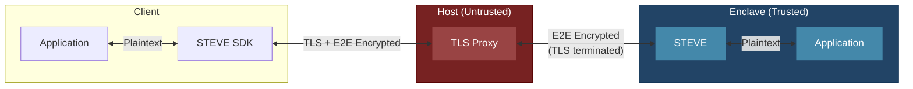

# STEVE

**S**ecure **T**ransport **E**ncryption **V**ia **E**nclave

End-to-end encryption for browser applications communicating with AWS Nitro Enclaves. With the v2 browser client active, application traffic is encrypted in the service worker and decrypted only inside the enclave.

> [!IMPORTANT]
> v2 binds fresh Nitro evidence to the exact X25519 session. It does not yet enforce expected PCRs, independently protect the service-worker bootstrap, or make STEVE fail closed when the service worker is absent. Those controls are separate work.

## Architecture



## Two Layers of Encryption

| Layer | From | To | Purpose |
|-------|------|-----|---------|
| **TLS** | Client | Host Proxy | Transport security (terminated at host) |
| **E2E** | STEVE SDK | STEVE | Application security (terminated in enclave) |

For requests intercepted by the active v2 worker, the host terminates TLS but only sees encrypted E2E payloads.

## How It Works

1. **Session request**: The browser generates a nonce and ephemeral X25519 key, and commits to its origin.
2. **Attested key exchange**: STEVE generates its own ephemeral key and asks Nitro to attest a transcript containing both keys, the nonce, session ID, origin context, and a key-derived binder.
3. **Verification and confirmation**: The browser verifies the Nitro chain, nonce, transcript values, and binder, then confirms possession of the derived keys.
4. **Request Flow**:
   - Application makes request through STEVE SDK
   - SDK encrypts payload with AES-256-GCM
   - Request travels over TLS to host proxy
   - Host terminates TLS, forwards E2E-encrypted payload to enclave
   - STEVE decrypts, forwards plaintext to enclave application
5. **Response Flow**: Responses use the reverse-direction key and the request sequence.

## Components

| Component | Location | Description |
|-----------|----------|-------------|
| `steve` | Enclave | Rust proxy - decrypts requests, encrypts responses |
| `steve-sdk` | Client (Rust) | Rust SDK for native applications |
| `steve-js-sdk` | Client (Browser) | Service worker for web applications |

## Security Properties

- **E2E Encryption**: Data encrypted client ↔ enclave (AES-256-GCM)
- **Attestation-Bound Keys**: Fresh Nitro evidence commits to the exact v2 session transcript and derived key binder
- **Forward Secrecy**: Ephemeral X25519 keys per session
- **Replay Resistance**: Directional keys, derived IVs, authenticated sequences, and a 64-entry server replay window
- **Host Isolation**: On the v2 path, the host sees only ciphertext despite terminating TLS

Current limitations:

- Expected PCR values are not enforced by the browser client.
- Plaintext requests are still forwarded when the service worker is absent; fail-closed routing is deferred.
- The first-load service-worker bootstrap is not independently trusted.
- The Rust client SDK is skeletal; v2 is currently browser-first.

## Usage

### Browser (JavaScript)

```javascript
import { registerEnclaveServiceWorker } from 'steve-js-sdk';

const client = await registerEnclaveServiceWorker();
await client.initialize();

// Same-origin fetch() calls are now transparently E2E encrypted
const response = await fetch('/api/secret');
```

The native Rust SDK does not yet implement the v2 client flow.
