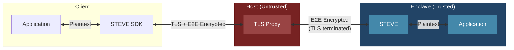

# STEVE

**S**ecure **T**ransport **E**ncryption **V**ia **E**nclave

End-to-end encryption for applications communicating with TEE enclaves. Traffic is encrypted on the client and only decrypted inside the enclave - the host cannot read it, because it is only able to terminate TLS, it does not have access to the E2E decryption key which is inside of the enclave.

## Architecture



## Two Layers of Encryption

| Layer | From | To | Purpose |
|-------|------|-----|---------|
| **TLS** | Client | Host Proxy | Transport security (terminated at host) |
| **E2E** | STEVE SDK | STEVE | Application security (terminated in enclave) |

The host terminates TLS but only sees encrypted E2E payloads. Even a compromised host cannot read application data.

## How It Works

1. **Attestation**: Client fetches attestation document, verifies enclave identity (PCRs), extracts STEVE's public key
2. **Key Exchange**: X25519 ECDH with the attested key establishes a shared secret
3. **Request Flow**:
   - Application makes request through STEVE SDK
   - SDK encrypts payload with AES-256-GCM
   - Request travels over TLS to host proxy
   - Host terminates TLS, forwards E2E-encrypted payload to enclave
   - STEVE decrypts, forwards plaintext to enclave application
4. **Response Flow**: Reverse of above

## Components

| Component | Location | Description |
|-----------|----------|-------------|
| `steve` | Enclave | Rust proxy - decrypts requests, encrypts responses |
| `steve-sdk` | Client (Rust) | Rust SDK for native applications |
| `steve-js-sdk` | Client (Browser) | Service worker for web applications |

## Security Properties

- **E2E Encryption**: Data encrypted client ↔ enclave (AES-256-GCM)
- **Attestation-Bound Keys**: Session keys tied to verified enclave identity
- **Forward Secrecy**: Ephemeral X25519 keys per session
- **Host Isolation**: Host sees only ciphertext despite terminating TLS

## Usage

### Browser (JavaScript)

```javascript
import { registerEnclaveServiceWorker } from 'steve-js-sdk';

const client = await registerEnclaveServiceWorker();
await client.initialize();

// All fetch() calls now transparently E2E encrypted
const response = await fetch('/api/secret');
```

### Native (Rust)

```rust
use steve_sdk::Client;

let client = Client::new("https://enclave.example.com").await?;
client.verify_attestation().await?;

let response = client.post("/api/secret", payload).await?;
```

