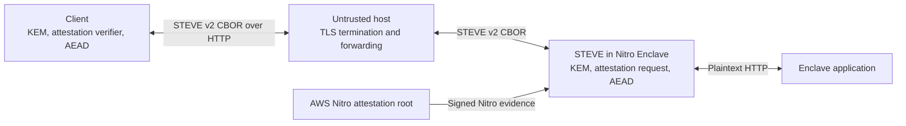

# STEVE v2 Protocol

## Status and requirements language

This document is the canonical specification of the STEVE version 2 secure
transport protocol. It specifies the wire protocol and cryptographic
construction. Client-specific behavior is explicitly marked **Informative**.
The exact wire identifier remains `STEVE-E2P-V2`, and the HTTP endpoints retain
their `/e2p/v2/` prefix for interoperability.

The key words **MUST**, **MUST NOT**, **REQUIRED**, **SHALL**, **SHALL NOT**,
**SHOULD**, **SHOULD NOT**, **RECOMMENDED**, **NOT RECOMMENDED**, **MAY**, and
**OPTIONAL** in this document are to be interpreted as described in
[BCP 14](https://www.rfc-editor.org/info/bcp14) when, and only when, they appear
in all capitals, as described by [RFC 2119](https://www.rfc-editor.org/rfc/rfc2119)
and [RFC 8174](https://www.rfc-editor.org/rfc/rfc8174).

## 1. Overview

STEVE v2 establishes an ephemeral, attested session between a client and STEVE
inside an AWS Nitro Enclave. The untrusted host forwards protocol messages but
does not receive the application plaintext or session traffic keys.



### 1.1 Roles and trust boundary

| Role | Responsibility |
| --- | --- |
| Client | Pins a key-exchange suite, creates fresh key material and a nonce, verifies Nitro evidence and the session binding, confirms the session, and protects application records. |
| STEVE | Runs inside the measured enclave, performs the selected key exchange, obtains per-session Nitro evidence, maintains session state, and proxies decrypted requests to the enclave application. |
| Untrusted host | Terminates TLS and forwards STEVE v2 messages. It is outside the STEVE v2 confidentiality and integrity boundary. |
| Nitro verifier | Validates the Nitro attestation document, including its signature chain, freshness policy, nonce, and any client-selected PCR policy. |
| Enclave application | Receives plaintext requests from STEVE over the enclave-local upstream connection. |

### 1.2 Security goals

For a client that correctly verifies Nitro evidence and its expected workload
identity, STEVE v2 is intended to provide:

- confidentiality and integrity for protected application requests and
  responses between that client and STEVE inside the attested enclave;
- cryptographic binding of the session identifier, selected suite, both
  key-exchange messages, client context, and derived shared secret to fresh
  Nitro evidence;
- explicit possession confirmation before application traffic is accepted;
- separation of client-to-server and server-to-client traffic keys and nonces;
- replay rejection within the defined session and replay-window semantics; and
- downgrade resistance through a client-pinned, process-fixed suite with no
  negotiation or fallback.

### 1.3 Non-goals

STEVE v2 does not itself provide:

- trusted delivery of the initial browser code, service worker, WASM, expected
  PCR values, or suite configuration;
- server-side authorization of a browser origin or client-supplied context;
- fail-closed routing for requests that are not intercepted by a STEVE v2 client;
- confidentiality of record sizes, timing, endpoints, session identifiers, or
  other transport metadata;
- availability against a host, network, or resource-exhaustion attacker;
- application authentication or authorization; or
- production-deployment proof merely because a protocol test or synthetic
  attestation succeeds.

## 2. Encoding and transport

All three protocol operations use HTTP `POST`. Requests and successful
responses use `Content-Type: application/cbor`. Successful responses have
status `200` and `Cache-Control: no-store`.

| Endpoint | Request | Successful response | Server request-body limit |
| --- | --- | --- | ---: |
| `/e2p/v2/session` | `SessionRequest` | `SessionResponse` | 4,096 bytes |
| `/e2p/v2/confirm` | `Envelope` | `Envelope` | 33,554,432 bytes |
| `/e2p/v2/request` | `Envelope` | `Envelope` | 33,554,432 bytes |

Protocol structures are CBOR maps with text-string keys. `uint` below means a
non-negative CBOR integer; `tstr` means a CBOR text string; `bstr` means a CBOR
byte string.

CBOR is used as a semantic encoding. STEVE v2 does **not** require canonical CBOR,
does not depend on map order, and never hashes serialized CBOR bytes. The
transcript is constructed independently as specified in [Section 5](#5-transcript).
This version does not define handling or negotiation semantics for extensions.

### 2.1 `SessionRequest`

| Field | CBOR type | Requirement |
| --- | --- | --- |
| `version` | `uint` | Exactly `2`. |
| `key_exchange` | `tstr` | Exactly `X25519` or `XWING-DRAFT10`; MUST equal the client pin and server process configuration. |
| `client_nonce` | `bstr` | Exactly 32 fresh, cryptographically random bytes. |
| `client_key_material` | `bstr` | Exactly the client size in [Section 4](#4-key-exchange-suites). |
| `context_hash` | `bstr` | Exactly 32 bytes. Its construction is a client-profile decision. |

The complete encoded request MUST NOT exceed 4,096 bytes.

### 2.2 `SessionResponse`

| Field | CBOR type | Requirement |
| --- | --- | --- |
| `version` | `uint` | Exactly `2`. |
| `key_exchange` | `tstr` | MUST equal the suite in the request and the client's pinned suite. |
| `session_id` | `bstr` | Exactly 16 fresh, cryptographically random bytes. |
| `server_key_material` | `bstr` | Exactly the server size in [Section 4](#4-key-exchange-suites). |
| `attestation_document` | `bstr` | Non-empty AWS Nitro attestation document carrying the binding in [Section 6](#6-nitro-attestation-binding). |
| `expires_in_seconds` | `uint` | `30`, the pending-session lifetime. |

### 2.3 `Envelope`

| Field | CBOR type | Requirement |
| --- | --- | --- |
| `version` | `uint` | Exactly `2`. |
| `session_id` | `bstr` | Exactly 16 bytes. |
| `sequence` | `bstr` | Exactly 8 bytes: the sequence number as an unsigned 64-bit big-endian integer. |
| `ciphertext` | `bstr` | AES-256-GCM ciphertext followed by its 16-byte authentication tag. |

The response envelope MUST repeat the request's `session_id` and `sequence`.

### 2.4 Protected application payloads

The plaintext protected by an application envelope is a CBOR map.

`ApplicationRequest`:

| Field | CBOR type | Requirement |
| --- | --- | --- |
| `method` | `tstr` | HTTP method. |
| `path` | `tstr` | Origin-relative path beginning with `/`; MUST NOT begin with `//` or contain a backslash, carriage return, or line feed. |
| `headers` | map of `tstr` to `tstr` | Zero or more HTTP header name/value pairs. |
| `body` | `bstr` or `null` | Request body, or `null` when absent. |

`ApplicationResponse`:

| Field | CBOR type | Requirement |
| --- | --- | --- |
| `status` | `uint` | HTTP status in the range 200 through 599. |
| `headers` | map of `tstr` to `tstr` | Zero or more HTTP response header name/value pairs. |
| `body` | `bstr` or `null` | Response body, or `null` when absent. |
| `error` | `tstr` or absent | Optional forwarding error. When `body` is absent, clients expose this as an error body. |

STEVE filters connection-specific and unsafe forwarding headers. Its protected
upstream response-body limit is 33,554,432 bytes. Because CBOR and AEAD add
overhead, the maximum usable application body is smaller than the enclosing
message limit.

### 2.5 Protocol errors

Handler-generated protocol errors use `Content-Type: application/json` with
the body `{"error":"<code>"}`.

| HTTP status | Code | Meaning |
| ---: | --- | --- |
| 400 | `protocol_error` | Malformed CBOR, invalid fields or sizes, suite mismatch, AEAD failure, or confirmation mismatch. |
| 401 | `invalid_session` | Unknown or expired session. |
| 409 | `replayed_sequence` | Duplicate, too-old, zero application, non-zero confirmation, or repeated confirmation sequence. |
| 413 | — | HTTP-layer rejection of an oversized confirmation or application request; a JSON body is not guaranteed. |
| 425 | `unconfirmed_session` | Application record received for a pending session. |
| 429 | `session_capacity` | Session, key-exchange, or attestation capacity is unavailable. |
| 500 | `internal_error` | Internal protocol processing failure. |
| 503 | `attestation_unavailable` | Nitro evidence could not be obtained. |

Clients MUST treat any non-success response as a failed protocol operation and
MUST NOT require a JSON body for errors generated outside the protocol handler.
Unknown `/e2p/` routes return HTTP 404 and are not protocol messages.

## 3. Protocol flow

The suite is selected out of band. A client MUST pin one suite before creating
a session. A server process serves one configured suite and MUST reject a
different request suite; neither peer negotiates or falls back.

```mermaid
sequenceDiagram
    participant C as Client
    participant H as Untrusted host
    participant S as STEVE in enclave
    participant N as Nitro Secure Module

    C->>C: Generate nonce and ephemeral KEM material
    C->>H: POST /session (suite, nonce, client material, context hash)
    H->>S: Forward SessionRequest
    S->>S: KEM; random session ID; transcript; HKDF
    S->>N: Attest(nonce = client_nonce, user_data = binding)
    N-->>S: Signed attestation document
    S-->>H: SessionResponse (server material, session ID, evidence)
    H-->>C: Forward SessionResponse
    C->>C: KEM; transcript; HKDF; verify evidence and binding
    C->>H: POST /confirm (C2S confirmation, sequence 0)
    H->>S: Forward Envelope
    S-->>H: S2C confirmation (sequence 0)
    H-->>C: Forward Envelope
    C->>H: POST /request (C2S application, sequence greater than 0)
    H->>S: Forward Envelope
    S-->>H: S2C application (same sequence)
    H-->>C: Forward Envelope
```

## 4. Key-exchange suites

Both suites produce a 32-byte `shared_secret`. All private and decapsulation
key material MUST be generated with a cryptographically secure random source,
MUST be fresh for each session, and SHOULD be destroyed after the handshake.

| Suite identifier | Client key material | Server key material | Operation |
| --- | ---: | ---: | --- |
| `X25519` | 32-byte ephemeral public key | 32-byte ephemeral public key | Ephemeral X25519 Diffie-Hellman as specified by [RFC 7748](https://www.rfc-editor.org/rfc/rfc7748). |
| `XWING-DRAFT10` | 1,216-byte encapsulation key | 1,120-byte ciphertext | X-Wing KEM as specified by [draft-connolly-cfrg-xwing-kem-10](https://datatracker.ietf.org/doc/html/draft-connolly-cfrg-xwing-kem-10). |

### 4.1 `X25519`

The client and server each generate a fresh ephemeral X25519 key pair and send
the 32-byte public-key encoding. Each peer computes X25519 using its private
key and the received public key. Each peer MUST reject a non-contributory
(all-zero) result.

### 4.2 `XWING-DRAFT10`

The client generates a fresh X-Wing decapsulation key and sends its 1,216-byte
encapsulation key. The server validates that key, encapsulates with fresh
randomness, and sends the resulting 1,120-byte ciphertext. The client
decapsulates it.

Decapsulation MUST use the draft-10 implicit-rejection behavior: an invalid
ciphertext produces a rejection secret rather than a validity oracle. Such a
secret will not match the server's secret, so the attestation binder or
confirmation fails. Implementations MUST NOT fall back to X25519 or another
suite after any X-Wing failure.

`XWING-DRAFT10` is a versioned wire identifier. An incompatible X-Wing draft or
final revision MUST use a new suite identifier.

## 5. Transcript

Let `suite` be the UTF-8 bytes of the exact suite identifier, and let `||`
denote byte concatenation. The transcript is:

```text
"STEVE-E2P-V2\0" || suite || 0x00 || client_nonce
|| client_key_material || server_key_material
|| session_id || context_hash
```

All fields following the suite separator have fixed sizes for the selected
suite, so the concatenation is unambiguous. The transcript hash is:

```text
transcript_hash = SHA-256(transcript)
```

The transcript MUST be constructed from the semantic field values, not from
serialized CBOR. It binds both key-exchange messages, the fresh nonce, the
server-generated session identifier, and the client-supplied context.

## 6. Nitro attestation binding

STEVE requests an AWS Nitro attestation document with two separate inputs:

```text
nonce     = client_nonce
user_data = UTF8(JSON(binding))
```

`nonce` is the raw 32-byte `client_nonce`; it is not a member of `user_data`.
The `user_data` JSON object contains:

| JSON member | Type | Required value |
| --- | --- | --- |
| `protocol` | string | `STEVE-E2P-V2` |
| `key_exchange` | string | Exact selected suite identifier. |
| `session_id` | string | Base64url without padding of the 16-byte session ID; 22 characters. |
| `transcript_hash` | string | Base64url without padding of the 32-byte transcript hash; 43 characters. |
| `binder` | string | Base64url without padding of the 32-byte binder from [Section 7](#7-key-schedule); 43 characters. |

The context hash and both key-exchange messages are not repeated in
`user_data`; they are committed through `transcript_hash`. JSON serialization
does not enter the STEVE v2 transcript or key schedule, and no canonical JSON form
is required; the complete `user_data` bytes are nevertheless protected by the
Nitro attestation signature. The UTF-8 JSON encoding MUST fit Nitro's
1,024-byte `user_data` limit.

Before confirmation, a client MUST:

1. validate the Nitro attestation document and its signature chain under the
   client's freshness and workload-identity policy;
2. verify that the Nitro `nonce` exactly equals `client_nonce`;
3. parse `user_data` as UTF-8 JSON;
4. verify all five members above against locally computed values; and
5. reject malformed or padded binary encodings and any mismatch.

The binder proves that the attested endpoint derived the same KEM shared
secret. The Nitro signature binds the binder and transcript hash to the
measured enclave evidence.

## 7. Key schedule

STEVE v2 uses HKDF-SHA256 as specified by
[RFC 5869](https://www.rfc-editor.org/rfc/rfc5869):

```text
PRK = HKDF-Extract(salt = transcript_hash, IKM = shared_secret)
output = HKDF-Expand(PRK, info = label, L)
```

| Output | Label (exact ASCII bytes) | Length |
| --- | --- | ---: |
| `c2s_key` | `steve-e2p-v2/c2s-key` | 32 bytes |
| `s2c_key` | `steve-e2p-v2/s2c-key` | 32 bytes |
| `c2s_iv_prefix` | `steve-e2p-v2/c2s-iv` | 4 bytes |
| `s2c_iv_prefix` | `steve-e2p-v2/s2c-iv` | 4 bytes |
| `binder` | `steve-e2p-v2/attestation-binder` | 32 bytes |

Each label is the complete HKDF `info`; no terminator or additional context is
appended. `c2s_key` and `s2c_key` are AES-256-GCM keys.

## 8. Record protection

The numeric identifiers are:

| Property | Name | Value |
| --- | --- | ---: |
| Direction | client to server | 0 |
| Direction | server to client | 1 |
| Message type | confirmation | 0 |
| Message type | application | 1 |

For direction `dir` and sequence number `seq`:

```text
nonce(dir, seq) =
    iv_prefix(dir) || I2OSP(seq, 8)

AAD(type, dir, session_id, seq) =
    "STEVE-E2P-V2\0" || type:u8 || dir:u8
    || session_id || I2OSP(seq, 8)

ciphertext =
    AES-256-GCM-Seal(key(dir), nonce(dir, seq), plaintext, AAD)
```

`I2OSP(seq, 8)` is the unsigned 64-bit big-endian representation. AES-GCM uses
a 96-bit nonce and a 128-bit authentication tag as specified by
[NIST SP 800-38D](https://csrc.nist.gov/pubs/sp/800/38/d/final).

### 8.1 Confirmation

Confirmation uses sequence `0` in both directions and message type
`confirmation`.

```text
C2S confirmation plaintext = transcript_hash
S2C confirmation plaintext = transcript_hash
```

The server MUST keep a newly created session pending until it authenticates the
client confirmation and its plaintext exactly equals `transcript_hash`. The
client MUST authenticate the server confirmation and compare the plaintext
before treating the session as active.

### 8.2 Application records and replay window

Application sequences MUST be greater than `0`. Clients allocate increasing
unsigned 64-bit sequence numbers beginning at `1`; the server returns the same
sequence in the response.

The server authenticates a client record before changing replay state. It then
maintains a 64-record sliding replay window:

- a sequence newer than the current high-water mark is accepted and advances
  the window;
- an unseen sequence within the previous 63 positions is accepted;
- a duplicate or a sequence at least 64 positions behind is rejected.

Clients MUST keep the span of outstanding requests below 64 so reordered valid
requests cannot fall outside the server window. A `(direction, sequence)` pair
MUST NOT be reused with the same session keys. A client MUST rotate the session
before sequence exhaustion.

## 9. Session lifecycle

| State | Lifetime | Accepted operation |
| --- | ---: | --- |
| Pending | 30 seconds from creation | One valid confirmation at sequence `0`. |
| Active | 30 minutes from successful confirmation | Application requests at sequences greater than `0`. |
| Expired | — | None. |

Activity does not extend either lifetime. Clients SHOULD rotate before server
expiry; the browser and native profiles currently rotate after 25 minutes.
Failures that make record-delivery status ambiguous SHOULD cause the client to
discard the session rather than reuse affected sequence numbers.

## 10. Client profiles (Informative)

This section describes current STEVE clients; it does not change the core wire
protocol.

### 10.1 Browser service-worker profile

- `context_hash = SHA-256(UTF8(self.location.origin))`.
- The browser verifies the Nitro signature chain, nonce, session binding,
  suite, transcript hash, and binder.
- It currently reports expected-PCR policy as `not-checked` and does not
  compare PCR0, PCR1, or PCR2 with independently supplied expected values.
  Therefore it verifies a Nitro-backed session binding but does not establish
  that the enclave is the expected STEVE deployment.
- `XWING-DRAFT10` uses self-hosted RustCrypto WASM whose build digest is checked
  before initialization. There is no cryptographic fallback.
- Service-worker interception is not a fail-closed routing boundary. A
  compromised first load or host can replace the page, worker, configuration,
  or WASM before those components enforce STEVE v2.

### 10.2 Native Rust SDK profile

- The normalized base origin has no trailing `/`.
- Without application context:

  ```text
  context_hash = SHA-256(UTF8(base_origin))
  ```

- With application context:

  ```text
  context_hash =
      SHA-256("STEVE-E2P-V2-NATIVE\0" || UTF8(base_origin)
              || 0x00 || application_context)
  ```

- The SDK requires independently supplied PCR0, PCR1, and PCR2. Each expected
  PCR is 48 bytes and all-zero debug PCRs are rejected.
- The SDK caps session, confirmation, and application protocol responses at
  65,536 bytes, 4,096 bytes, and 33,619,968 bytes respectively.
- Redirects are disabled and protocol responses must remain on the configured
  base origin.

In both profiles, `context_hash` is a client commitment included in the
transcript. The server does not authenticate how it was constructed, so it is
not server-side origin authorization.

## 11. Security considerations

### 11.1 Protocol assurance

STEVE v2 combines standard primitives—X25519 or X-Wing, SHA-256, HKDF-SHA256,
AES-256-GCM, CBOR, COSE, and Nitro attestation—but the composition and state
machine are STEVE-specific. It is not a standardized secure-channel protocol
and should receive independent cryptographic and implementation review.

`XWING-DRAFT10` is based on an IETF Internet-Draft, not a final standard. Its
hybrid construction includes ML-KEM, standardized in
[FIPS 203](https://csrc.nist.gov/pubs/fips/203/final), and X25519, but draft-10
interoperability and security assumptions remain revision-specific.

### 11.2 Attestation and PCR policy

Nitro evidence is rooted in the AWS Nitro attestation PKI. A valid signature
and matching nonce prove freshness and Nitro provenance; they do not by
themselves identify the intended workload. Clients that need workload identity
MUST compare the relevant PCRs or another independently trusted identity policy.
See the AWS description of the
[Nitro attestation document and root of trust](https://docs.aws.amazon.com/enclaves/latest/user/verify-root.html).

### 11.3 Bootstrap and plaintext paths

STEVE v2 protection begins only after trusted client code and policy are
running. Deployments must protect delivery of those components separately.
STEVE also supports ordinary plaintext proxying outside the STEVE v2 endpoints;
operators must ensure that sensitive routes cannot bypass the intended
client-side protection.

### 11.4 Metadata and denial of service

The host can observe and manipulate connection timing, ciphertext lengths,
session creation frequency, protocol endpoints, session identifiers, and
availability. It can drop, delay, reorder, replay, or flood messages. AEAD and
the replay window detect unauthorized modification and bounded replays but
cannot ensure progress or hide this metadata.

### 11.5 Browser and WASM limitations

Browser security depends on the browser runtime, service-worker lifecycle,
same-origin asset delivery, and the integrity of the shipped client code.
Digest-checking the X-Wing WASM detects an unexpected WASM asset relative to
the already loaded JavaScript expectation; it does not create a trusted
first-load channel or provide independently pinned workload identity.

## 12. Versioning

Protocol version `2` fixes the transcript, key schedule, attestation binding,
envelope, record identifiers, and state semantics in this document.

- An incompatible X-Wing revision MUST receive a new suite identifier.
- A change to the transcript, key schedule, attested binding, envelope,
  direction or message-type identifiers, confirmation rules, replay behavior,
  or lifecycle semantics MUST receive a new protocol version.
- Implementations MUST NOT silently negotiate or fall back across protocol
  versions or key-exchange suites.

## 13. Interoperability vectors

The following files are normative interoperability examples:

- [`e2p-v2.json`](../test-vectors/e2p-v2.json) covers the complete X25519
  session request and response, transcript, HKDF outputs, binder, and
  confirmation record.
- [`e2p-v2-xwing.json`](../test-vectors/e2p-v2-xwing.json) covers the same STEVE v2
  surface for `XWING-DRAFT10`.
- [`xwing-draft10.json`](../test-vectors/xwing-draft10.json) contains the three
  vendored draft-10 X-Wing known-answer tests; its source checksum is recorded
  in [`xwing-draft10.sha256`](../test-vectors/xwing-draft10.sha256).

Conforming implementations MUST reproduce the protocol transcript, transcript
hash, key-schedule outputs, binder, nonces, AAD, and protected records in the
applicable STEVE v2 vector. X-Wing implementations MUST additionally match the
vendored draft-10 known-answer tests.
